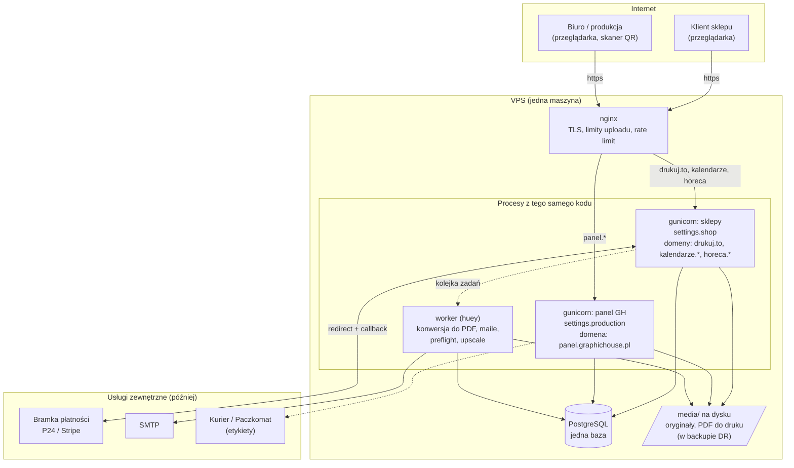
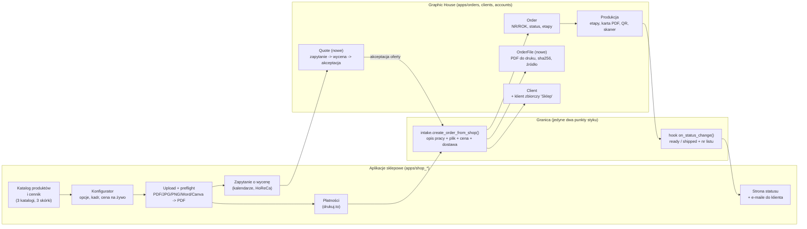
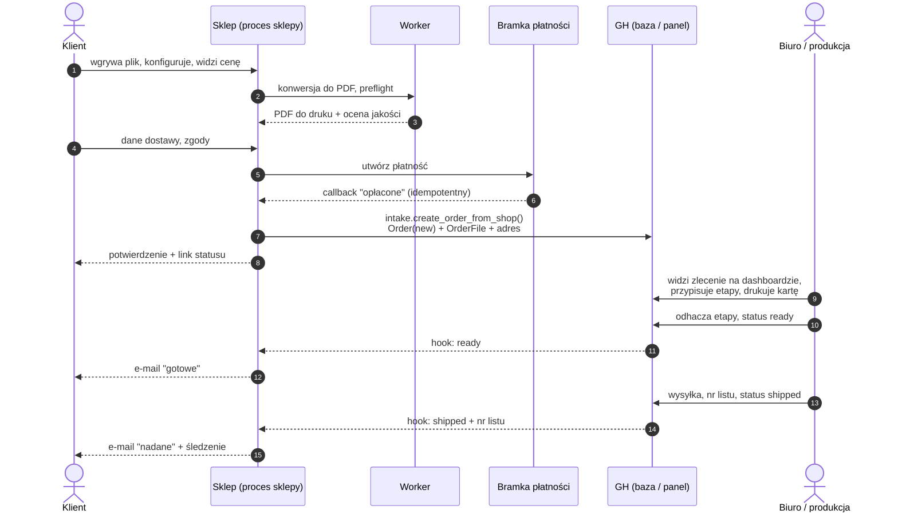
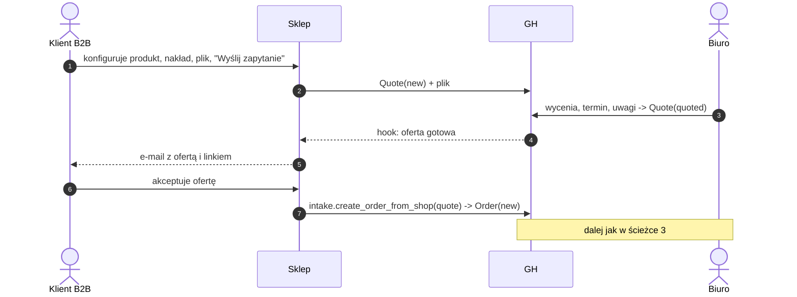

# Architektura: sklepy + Graphic House na jednym VPS

Stan: propozycja z 2026-09-27, przed decyzją klienta. Założenie: jeden kod (repo graphic_house),
jedna baza, dwa procesy www (panel i sklepy), jeden worker.

## 1. Wdrożenie na VPS

## 2. Podział odpowiedzialności w kodzie

## 3. Ścieżka zamówienia (drukuj.to, cena natychmiast)

## 4. Ścieżka z wyceną (kalendarze, HoReCa)

## Co jest nowe względem dzisiejszego GH

- `OrderFile`, `Quote`, pole na numer zamówienia sklepu i numer listu, status płatności "online".
- Klient zbiorczy "Sklep" albo `Client` bez NIP.
- Drugi plik ustawień i drugi proces gunicorn dla domen sklepów.
- Worker (dziś GH nie ma zadań w tle).
- Hook na zmianie statusu (dziś status zmienia się tylko w panelu i nigdzie nie wychodzi).
