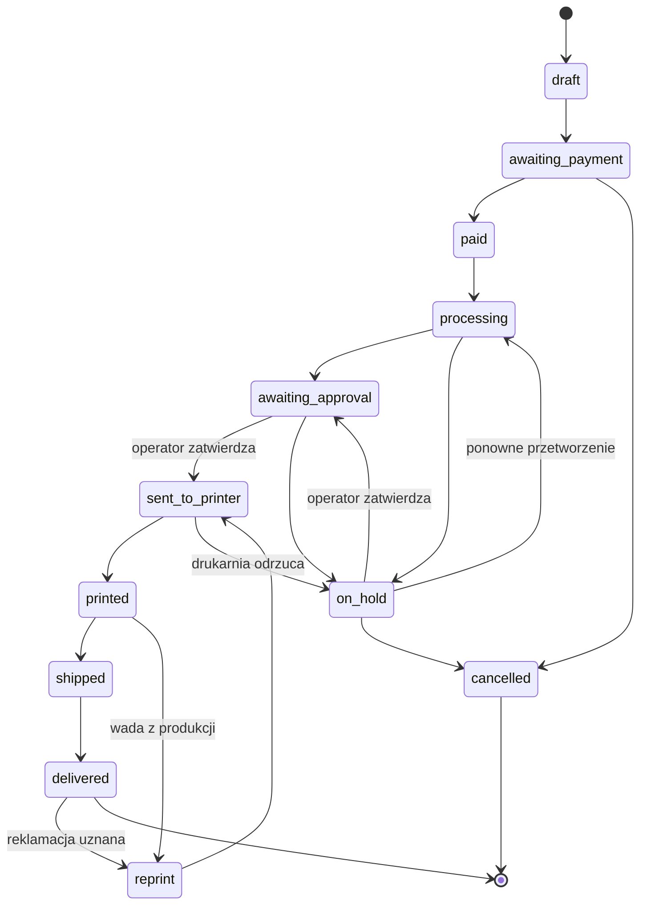

# SEED — serwis druku obrazków AI (nazwa robocza: `NAZWA_ROBOCZA`)

## 0. Jak czytać ten dokument

- To jest seed dla agenta budującego **demo**. Opisuje *co* serwis robi i *z czego* się składa. **Nie opisuje, jak wygląda.**
- Rozdział „Ekrany” to listy zawartości i akcji, nie układy. Layout, kolory, typografia, ikony i animacje są celowo pominięte — zostaną dopracowane później w Claude Design. Agent buduje szkielet neutralny wizualnie (poziom wireframe), z wymiennymi szablonami i tokenami CSS.
- Oznaczenia:
  - `[DECYZJA]` — ustalone, nie zmieniać bez pytania.
  - `[PROPOZYCJA]` — sensowny domyślny wybór, można zmienić.
  - `[ZAŁOŻENIE]` — przyjęte w ciemno, do potwierdzenia z drukarnią (lista w §16).

## 1. Kontekst i cel

- Partner: drukarnia drukująca pojedyncze sztuki na zamówienie. Dostaje coraz więcej zleceń z grafikami generowanymi przez AI, często w za słabej jakości do druku. Sama wyszła z inicjatywą zbudowania serwisu.
- Produkt: serwis www, w którym klient wgrywa obrazek, system ocenia i poprawia plik, klient wybiera format i widzi podgląd, płaci, a zamówienie automatycznie trafia do drukarni, która drukuje i wysyła.
- Ten seed opisuje demo budowane **bez danych od drukarni**, do pokazania jej jako propozycja. Wszystkie integracje zewnętrzne (upscale, moderacja treści, płatność, drukarnia, kurier) są symulowane za wymiennymi interfejsami.
- Cel demo: pokazać pełną ścieżkę od uploadu do paczki, panel operatora oraz kontrakt integracji z drukarnią na tyle konkretnie, żeby drukarnia mogła powiedzieć „tak, to podepniemy” albo „u nas to działa inaczej”.

## 2. Zakres

### W zakresie demo

- Jeden typ produktu: **plakat** `[DECYZJA]`.
- Formaty: A3, A2, 50×70 cm, B2 `[PROPOZYCJA]`. Papier: matowy, satynowy `[PROPOZYCJA]`. Opcja białego marginesu (tak/nie).
- Upload JPG / PNG / WebP, limit 30 MB `[PROPOZYCJA]`.
- Analiza pliku: rozdzielczość względem wybranego formatu, proporcje, wstępna klasyfikacja treści (stub).
- Enhancer: upscale (symulacja), kadrowanie, generowanie PDF ze spadami.
- Prosty mockup na ścianie w skali.
- Zamówienie gościa (bez konta): jedna pozycja, ilość 1–N `[PROPOZYCJA]`.
- Płatność (symulacja).
- Maszyna stanów zamówienia, publiczna strona statusu, powiadomienia e-mail (w demo do logu/konsoli).
- Panel operatora.
- Symulowana drukarnia z własnym pulpitem.
- Dane demo i scenariusz prezentacji.

### Poza zakresem

- Inne produkty (koszulki, kubki, naklejki, canvas).
- Konta klientów, historia zamówień, logowanie klienta.
- Publiczna galeria, marketplace, udostępnianie prac.
- Generowanie obrazków w serwisie.
- API B2B dla innych aplikacji.
- Prawdziwe integracje (upscale, płatności, kurier, drukarnia).
- Wielojęzyczność (tylko polski).
- Faktury VAT (w demo wystarczy podsumowanie zamówienia).
- Outpainting (dorysowanie brzegów) — tylko interfejs bez implementacji.

## 3. Role

- **Klient (gość)** — wgrywa plik, konfiguruje, płaci, śledzi zamówienie, może zgłosić reklamację.
- **Operator** — osoba z drukarni lub właściciel serwisu. Moderuje, kontroluje pliki, zmienia stany ręcznie, zleca dodruki. Loguje się (Django auth, `is_staff`).
- **Drukarnia** — system zewnętrzny, w demo symulowany. Przyjmuje zlecenia, raportuje statusy.
- **System** — pipeline pliku, maszyna stanów, powiadomienia, integracje.

## 4. Ścieżki użytkownika

### 4.1 Ścieżka główna

1. Klient wgrywa obrazek.
2. System analizuje plik: wymiary, proporcje, treść. Zapisuje wynik i ocenę jakości dla każdego formatu.
3. Klient wybiera format, papier, margines, ilość. Widzi kadr w proporcji formatu i ocenę jakości dla wybranego formatu: `ostry` / `ok` / `wymaga poprawy` / `za słaby`. Przy `wymaga poprawy` enhancer jest zaproponowany automatycznie; klient może go włączyć lub wyłączyć. Przy `za słaby` format jest zablokowany z propozycją mniejszego.
4. Podgląd: mockup na ścianie, wycinek 1:1 przed/po (symulacja na małym fragmencie), ostrzeżenie o kolorach.
5. Dane dostawy, e-mail, zgody.
6. Płatność (symulacja): sukces lub błąd.
7. Po płatności system uruchamia pipeline (upscale → kadr → PDF), a zamówienie trafia do kolejki moderacji operatora.
8. Operator zatwierdza → zlecenie idzie do drukarni.
9. Drukarnia: przyjęte → wydrukowane → nadane (numer śledzenia).
10. Klient widzi zmiany na stronie statusu i dostaje e-mail przy każdej zmianie stanu.

### 4.2 Ścieżki wyjątkowe

- **Plik za słaby** nawet po upscale → format zablokowany, propozycja mniejszego formatu.
- **Wątpliwa treść** (flaga ze stubu lub ręcznie) → zamówienie `on_hold` → operator zatwierdza albo anuluje ze zwrotem (symulacja zwrotu).
- **Błąd pipeline** (wyjątek w przetwarzaniu) → `on_hold` z powodem technicznym; operator może wymusić ponowne przetworzenie.
- **Płatność nieudana** → zamówienie zostaje w `awaiting_payment`, klient może spróbować ponownie.
- **Drukarnia odrzuca zlecenie** (np. zły plik) → `on_hold` z powodem od drukarni.
- **Wada z produkcji** (zgłasza operator lub drukarnia) → `reprint` → nowe zlecenie do drukarni z tym samym plikiem, powiązane z pierwotnym.
- **Reklamacja klienta** (formularz na stronie statusu po dostarczeniu) → operator decyduje: dodruk lub odrzucenie z uzasadnieniem.

## 5. Ekrany

Bez layoutu. Dla każdego ekranu: cel, zawartość, akcje, dokąd prowadzi. Kolejność elementów na liście nie jest kolejnością na ekranie.

### 5.1 Klient

**S1 — Start i upload**
- Cel: wgrać plik w jednym kroku, bez rejestracji.
- Zawartość: jednozdaniowe wyjaśnienie usługi, pole uploadu (przeciągnij lub wybierz), obsługiwane formaty i limit, link do regulaminu.
- Akcje: wgraj plik. Po analizie → S2.
- Błędy: zły typ pliku, za duży plik, uszkodzony obraz.

**S2 — Konfiguracja**
- Cel: wybrać, co ma być wydrukowane i w jakiej jakości.
- Zawartość: miniatura wgranego pliku i jego wymiary w px; wybór formatu (każdy z oceną jakości), papieru, marginesu, ilości; podgląd kadru w proporcji formatu z przesuwaniem i przybliżaniem; przełącznik enhancera z krótkim opisem, co robi; cena aktualizowana przy każdej zmianie.
- Akcje: zmień opcje, przejdź do podglądu → S3, wgraj inny plik → S1.

**S3 — Podgląd**
- Cel: dać klientowi pewność, że wydruk wyjdzie dobrze.
- Zawartość: mockup na ścianie w skali z odniesieniem wielkości; wycinek 1:1 przed i po enhancerze; ostrzeżenie o kolorach (wydruk jest ciemniejszy i mniej nasycony niż ekran); podsumowanie wyboru i ceny.
- Akcje: wróć do konfiguracji → S2, zamawiam → S4.

**S4 — Dane i dostawa**
- Cel: zebrać minimum danych do wysyłki.
- Zawartość: e-mail, imię i nazwisko, adres, telefon; wybór dostawy: kurier lub paczkomat `[PROPOZYCJA]`; zgody: regulamin, informacja o braku prawa odstąpienia dla produktu personalizowanego, oświadczenie o prawach do wgranego obrazka.
- Akcje: przejdź do płatności → S5.

**S5 — Płatność (symulacja)**
- Cel: zasymulować bramkę.
- Zawartość: podsumowanie kwoty, wyraźny napis „symulacja płatności”.
- Akcje: zapłać (sukces) → S6, symuluj błąd → komunikat i powrót.

**S6 — Potwierdzenie**
- Zawartość: numer zamówienia, link do strony statusu, informacja, co się teraz dzieje i kiedy spodziewać się paczki `[ZAŁOŻENIE: czas realizacji]`.

**S7 — Status zamówienia** (publiczny link z tokenem, bez logowania)
- Zawartość: aktualny stan opisany po polsku dla laika, historia stanów z datami, miniatura, wybrane opcje, numer śledzenia gdy jest, formularz reklamacji dostępny po `delivered`.
- Akcje: zgłoś reklamację (opis + zdjęcia).

**S8 — Strony statyczne**
- Regulamin, polityka prywatności, FAQ — placeholdery z nagłówkami.

### 5.2 Operator

**O1 — Logowanie** — standardowy Django auth.

**O2 — Lista zamówień**
- Zawartość: tabela zamówień (numer, data, klient, format, stan, kwota), filtry po stanie, szukanie po numerze i e-mailu, licznik „wymaga uwagi” (`awaiting_approval` + `on_hold` + reklamacje).
- Akcje: otwórz zamówienie → O3.

**O3 — Szczegóły zamówienia**
- Zawartość: dane klienta i dostawy; wybrane opcje; plik oryginalny obok pliku po przetworzeniu z danymi technicznymi (px, efektywne DPI dla formatu, rozmiar); wynik analizy i flagi treści; historia stanów z czasem, autorem i powodem; lista zleceń do drukarni z ich statusami; wysyłka; płatność; reklamacje.
- Akcje: zatwierdź, odrzuć (powód obowiązkowy), wymuś ponowne przetworzenie, zmień stan ręcznie (powód obowiązkowy), zleć dodruk, pobierz PDF do druku, anuluj ze zwrotem.

**O4 — Kolejka moderacji**
- Zawartość: zamówienia w `awaiting_approval` i `on_hold`, każde z podglądem pliku i najważniejszymi danymi.
- Akcje: zatwierdź / odrzuć bez wchodzenia w szczegóły, otwórz szczegóły → O3.

**O5 — Ustawienia demo**
- Zawartość: cennik formatów i papierów, progi jakości (DPI), przełącznik auto-zatwierdzania (w demo domyślnie wyłączony), przełącznik auto-symulacji drukarni.

### 5.3 Symulowana drukarnia

**D1 — Pulpit drukarni**
- Osobny widok pod `/mock-printer/`, wyraźnie oznaczony jako symulacja. Ma celowo wyglądać jak obce, proste narzędzie, nie jak część serwisu.
- Zawartość: lista otrzymanych zleceń ze specyfikacją (JSON z §8), plik do pobrania, aktualny status.
- Akcje na zleceniu: przyjmij, odrzuć (powód), oznacz jako wydrukowane, oznacz jako nadane (generuje losowy numer śledzenia), zgłoś wadę. Każda akcja wywołuje ten sam webhook, którego użyłaby prawdziwa drukarnia.
- Przełącznik auto-symulacji: zlecenia przechodzą kolejne statusy co N sekund.

## 6. Model domenowy

### 6.1 Encje

- `Asset` — wgrany plik: `id`, `original_file`, `mime`, `width`, `height`, `sha256`, `created_at`, `expires_at`.
- `AssetAnalysis` — wynik analizy: `asset`, `aspect_ratio`, `content_flags` (JSON), `quality_per_format` (JSON: kod formatu → `effective_dpi`, `verdict`), `analyzed_at`.
- `AssetVersion` — kolejne wersje pliku: `asset`, `kind` (`original` | `preview` | `upscaled` | `cropped` | `print_pdf`), `file`, `width`, `height`, `provider`, `params` (JSON), `created_at`.
- `Format` — format wydruku: `code`, `name`, `width_mm`, `height_mm`, `bleed_mm`, `base_price`, `is_active`.
- `PaperOption` — `code`, `name`, `price_delta`.
- `Order` — `number` (czytelny, np. `PA-2026-000123`), `status`, `email`, `full_name`, `phone`, `shipping_address` (JSON), `delivery_method`, `total`, `currency`, `status_token` (publiczny, 32 znaki), `consents` (JSON z czasem), `created_at`, `updated_at`.
- `OrderItem` — `order`, `asset`, `format`, `paper`, `white_margin`, `quantity`, `crop` (JSON: znormalizowany prostokąt), `enhancer_enabled`, `unit_price`.
- `OrderStatusEvent` — `order`, `from_status`, `to_status`, `actor` (`system` | `operator` | `printer` | `customer`), `actor_user` (opcjonalnie), `reason`, `created_at`.
- `PrintJob` — `order_item`, `external_id`, `status`, `print_file` (wersja `print_pdf`), `spec` (JSON), `sent_at`, `reprint_of` (self FK, opcjonalnie), `idempotency_key`.
- `PrintJobEvent` — `print_job`, `status`, `payload` (JSON), `received_at`.
- `Shipment` — `order`, `carrier`, `tracking_number`, `shipped_at`.
- `Payment` — `order`, `provider`, `external_id`, `amount`, `status`, `events` (JSON).
- `Complaint` — `order`, `description`, `photos`, `status` (`open` | `reprint` | `rejected`), `resolution`, `created_at`.

### 6.2 Stany zamówienia `[DECYZJA]`

| Stan | Znaczenie | Kto ustawia |
|---|---|---|
| `draft` | konfiguracja w toku, przed płatnością | system |
| `awaiting_payment` | klient przeszedł do płatności | system |
| `paid` | płatność potwierdzona | system (callback) |
| `processing` | pipeline pliku w toku | system |
| `awaiting_approval` | plik gotowy, czeka na operatora | system |
| `on_hold` | wstrzymane: treść, błąd pipeline, odrzucenie przez drukarnię | system / operator / drukarnia |
| `sent_to_printer` | zlecenie wysłane i przyjęte | system / drukarnia |
| `printed` | drukarnia zgłosiła wydruk | drukarnia |
| `shipped` | nadane, jest numer śledzenia | drukarnia |
| `delivered` | doręczone, zamówienie zamknięte | drukarnia / operator / system po X dniach |
| `reprint` | zlecono dodruk, nowe zlecenie w drodze | operator |
| `cancelled` | anulowane, zwrot zlecony | operator / system |



Zasady:
- Każde przejście przez jedną funkcję `orders.services.transition(order, to_status, actor, reason)`. Przejścia spoza tabeli rzucają wyjątek. Każde przejście zapisuje `OrderStatusEvent` i wysyła powiadomienie, jeśli stan jest widoczny dla klienta.
- Operator może wymusić dowolne przejście ręcznie tylko z podanym powodem — jest to osobna funkcja `force_transition`, logowana jako `actor=operator`.
- Stany widoczne dla klienta mają osobne, ludzkie etykiety w jednym słowniku (np. `processing` → „Przygotowujemy plik do druku”).

### 6.3 Stany zlecenia do drukarni

`created` → `sent` → `accepted` → `printed` → `shipped`; boczne: `rejected`, `failed`. Mapowanie na stan zamówienia w `printing.services`.

## 7. Pipeline pliku

Każdy etap to interfejs z implementacją demo. Implementacje demo mają w nazwie `Mock` i wyświetlają w UI etykietę „symulacja” tam, gdzie klient widzi ich efekt.

- `AnalysisService.analyze(asset) -> AssetAnalysis` — **prawdziwa implementacja** na Pillow: wymiary, proporcje, dla każdego formatu `effective_dpi = min(width_px / (width_mm / 25.4), height_px / (height_mm / 25.4))` po dopasowaniu kadru. Werdykt wg progów z ustawień `[PROPOZYCJA]`: `ostry` ≥ 200 DPI, `ok` 120–200, `wymaga poprawy` 30–120 (po upscale ×4 osiągnie ≥ 120), `za słaby` < 30.
- `ContentSafetyService.check(image) -> flags` — demo: `MockContentSafety` zwraca brak flag, ale flaguje pliki, których nazwa zawiera `nsfw`, `logo` lub `brand` (do pokazania ścieżki `on_hold` na prezentacji). Docelowo: zewnętrzny klasyfikator NSFW + wykrywanie znanych IP.
- `UpscaleService.upscale(image, factor) -> image` — demo: `MockUpscale` robi resize LANCZOS ×4 z lekkim wyostrzeniem i sztucznym opóźnieniem 3–8 s. Docelowo: model klasy Real-ESRGAN przez zewnętrzne API; tryb „kreatywny” tylko jako świadomy wybór z podglądem (poza demo).
- `CropService.crop(image, rect, target_ratio) -> image` — prawdziwa implementacja, kadr z `OrderItem.crop`.
- `OutpaintService` — tylko interfejs, `NotImplemented` w demo.
- `PrepressService.build_pdf(image, format, white_margin) -> pdf` — prawdziwa, uproszczona: strona = format + spady, obraz skalowany do pola ze spadem, przy białym marginesie obraz pomniejszony wewnątrz; metadane w PDF. W demo RGB; CMYK i profil kolorów `[ZAŁOŻENIE]`.
- `MockupService.render(image, format) -> image` — prosty montaż na jednym zdjęciu ściany w skali, tylko do podglądu.

Uruchomienie: `assets.services.run_pipeline(order_item)` w tle po `paid`. Kolejno: upscale (jeśli włączony) → crop → PDF. Każdy etap zapisuje `AssetVersion`. Wyjątek → `on_hold` z powodem technicznym, bez utraty poprzednich wersji. Pipeline jest idempotentny: ponowne uruchomienie nadpisuje wersje danego rodzaju.

Koszt: pełny upscale tylko po płatności `[DECYZJA]`. Podgląd przed/po na S3 działa na wycinku ok. 300×300 px, więc jest tani.

## 8. Integracja z drukarnią

### 8.1 Interfejs

```python
class PrintProvider(Protocol):
    def submit(self, job: PrintJob) -> str: ...        # zwraca external_id
    def cancel(self, external_id: str) -> None: ...
    def fetch_status(self, external_id: str) -> str: ... # pull, opcjonalne
```

Push: endpoint `POST /api/printer/events/` z podpisem HMAC w nagłówku, payload `{external_id, status, tracking_number?, reason?, timestamp}`.

Idempotencja: `submit` wysyła `idempotency_key = print_job.id`. Ponowne wysłanie tego samego klucza musi zwrócić ten sam `external_id`, nie tworzyć drugiego zlecenia. Retry po stronie serwisu z backoffem, maksymalnie 5 prób, potem `on_hold`.

Implementacje:
- `MockPrintProvider` `[DECYZJA na demo]` — zapisuje zlecenie do tabeli widocznej w D1; akcje z D1 wołają webhook tą samą ścieżką, co prawdziwa drukarnia.
- `HotFolderPrintProvider`, `EmailPrintProvider`, `HttpPrintProvider` — tylko puste klasy z docstringiem, do wyboru po rozmowie z drukarnią `[ZAŁOŻENIE: sposób przyjmowania zleceń]`.

### 8.2 Specyfikacja zlecenia (JSON)

```json
{
  "job_id": "pj_01J9X…",
  "order_number": "PA-2026-000123",
  "product": "poster",
  "format": {"code": "A2", "width_mm": 420, "height_mm": 594, "bleed_mm": 3},
  "paper": "matte",
  "quantity": 1,
  "white_margin": false,
  "file": {"url": "https://…/print.pdf", "sha256": "…", "color_space": "RGB"},
  "shipping": {
    "method": "courier",
    "name": "Jan Kowalski",
    "address": {"line1": "…", "postal_code": "00-001", "city": "Warszawa", "country": "PL"},
    "phone": "+48…",
    "email": "jan@…"
  },
  "reprint_of": null,
  "created_at": "2026-09-22T10:00:00Z"
}
```

Pola `file.color_space`, `bleed_mm`, format pliku (PDF vs TIFF) i to, kto generuje etykietę kurierską, są `[ZAŁOŻENIE]`.

## 9. Płatności

```python
class PaymentProvider(Protocol):
    def create(self, order: Order) -> str: ...            # zwraca URL przekierowania
    def handle_callback(self, request) -> PaymentResult: ...
    def refund(self, payment: Payment, amount) -> None: ...
```

Demo: `MockPaymentProvider` z ekranem S5. Docelowo Przelewy24 (BLIK) lub Stripe `[PROPOZYCJA]`. Callback musi być idempotentny (ten sam `external_id` dwa razy nie oznaczy zamówienia dwa razy).

## 10. Panel operatora

Zakres w §5.2. Zasady:
- Tylko `is_staff`.
- Każda akcja operatora zapisuje `OrderStatusEvent` z `actor_user`.
- Odrzucenie, ręczna zmiana stanu i anulowanie wymagają powodu.
- Panel nie jest Django adminem; admin zostaje jako narzędzie awaryjne.

## 11. Symulowana drukarnia

Zakres w §5.3. Zasady:
- Ten sam kod, który obsłuży prawdziwą drukarnię: `MockPrintProvider.submit` tworzy rekord, D1 wywołuje webhook przez HTTP do własnej aplikacji (nie skrótem w kodzie), żeby kontrakt był widoczny na prezentacji.
- Auto-symulacja: zadanie w tle posuwa zlecenia `accepted → printed → shipped` co N sekund (ustawienie w O5), domyślnie wyłączona, żeby na prezentacji klikać ręcznie.

## 12. Wymagania niefunkcjonalne

- Język: polski, komunikaty zrozumiałe dla osoby nietechnicznej; żargon (DPI, spady) tylko w panelu operatora, dla klienta opisowo („wystarczająco ostry do A2”).
- Upload: 30 MB, JPG/PNG/WebP, walidacja po stronie serwera, obraz otwierany bezpiecznie (limit pikseli Pillow).
- Retencja: pliki usuwane 30 dni po `delivered` lub `cancelled`, porzucone `draft` po 7 dniach `[PROPOZYCJA]`; komenda `cleanup_assets`.
- Dane osobowe: tylko to, co potrzebne do wysyłki; e-maile w demo do konsoli (`console.EmailBackend`).
- Strona statusu: dostęp tylko przez token, bez enumeracji numerów zamówień.
- Wszystkie zmiany stanu logowane; brak „cichych” zmian.
- Testy: tabela przejść stanów, obliczanie DPI i werdyktów, pipeline z mockami, idempotencja `submit` i callbacku płatności, webhook z błędnym podpisem.
- Świeża instalacja: `docker compose up` + `manage.py migrate` + `manage.py seed_demo` daje działające demo w kilka minut.

## 13. Stack

- **Django** `[DECYZJA]`, Python 3.12+, Django 5.2 LTS lub nowszy.
- Baza: PostgreSQL w docker compose; SQLite dopuszczalne lokalnie `[PROPOZYCJA]`.
- Frontend: szablony Django + HTMX + minimalny vanilla JS (kadrowanie, podgląd, upload z paskiem postępu) `[PROPOZYCJA]`. Uzasadnienie: layout żyje w szablonach i da się go wymienić po Claude Design bez ruszania logiki. Jeśli design wyjdzie w React, logika w `services.py` pozwala dołożyć DRF bez przepisywania.
- Style: jeden plik `tokens.css` (zmienne CSS: kolory, odstępy, skala typograficzna, promienie) + minimalny `base.css`. **Bez Tailwind, Bootstrap i bibliotek komponentów** `[DECYZJA]`. Klasy nazwane po roli (`.upload-dropzone`, `.order-summary`), nie po wyglądzie.
- Obrazy: Pillow. PDF: reportlab `[PROPOZYCJA]`.
- Zadania w tle: huey (backend SQLite lub Redis) `[PROPOZYCJA]`; alternatywnie Celery + Redis, jeśli już znany.
- Pliki: lokalny system plików w demo, `django-storages` (S3) później.
- Struktura aplikacji: `catalog` (formaty, papiery, ceny), `assets` (upload, analiza, wersje, pipeline), `orders` (zamówienie, stany, płatność, powiadomienia), `printing` (zlecenia, providery, webhook, mock drukarni), `ops` (panel operatora), `web` (widoki klienta), `demo` (seed, fixtures).
- Logika biznesowa w `services.py` każdej aplikacji; widoki cienkie.

## 14. Dane demo

- Fixtures: formaty z cenami (zmyślone `[ZAŁOŻENIE]`: A3 59 zł, A2 89 zł, 50×70 99 zł, B2 119 zł), papiery (matowy 0 zł, satynowy +10 zł), dostawa (kurier 19 zł, paczkomat 14 zł).
- Obrazki testowe w `demo/images/`:
  - `small_512.png` — za słaby na A2 nawet po upscale,
  - `typical_1024.png` — wymaga enhancera na A2, ok na A3,
  - `large_3000.jpg` — ostry bez enhancera,
  - `panorama_2048x768.jpg` — złe proporcje, pokazuje kadrowanie,
  - `logo_test.png` — wpada w moderację.
- `manage.py seed_demo`: konto operatora `demo / demo`, ok. 15 zamówień rozłożonych po wszystkich stanach z pełną historią, jedno z reklamacją, jedno z dodrukiem, dwa w kolejce moderacji.

## 15. Scenariusz prezentacji (ok. 5 minut)

1. S1: wgraj `typical_1024.png`. S2: pokaż ocenę — A3 `ok`, A2 `wymaga poprawy`, B2 `za słaby`.
2. Wybierz A2, włącz enhancer, przesuń kadr, pokaż cenę na żywo.
3. S3: mockup na ścianie, wycinek przed/po.
4. S4 → S5: zapłać (symulacja). S6: numer i link do statusu.
5. O4: zamówienie czeka w kolejce; O3: plik przed/po z DPI, PDF do pobrania. Zatwierdź.
6. D1: pokaż zlecenie z JSON i plikiem. Klikaj: przyjmij → wydrukowane → nadane.
7. S7: strona statusu klienta zmienia się po każdym kliknięciu; e-mail w logu.
8. Ścieżka wyjątku: wgraj `logo_test.png`, opłać → `on_hold` → O3: odrzuć z powodem → zwrot (symulacja).
9. O2: lista z filtrami, licznik „wymaga uwagi”, dodruk na jednym z zamówień.

## 16. Założenia do potwierdzenia z drukarnią

- Formaty, papiery, minimalne i maksymalne wymiary.
- Koszty produkcji per format (do cennika i podziału marży).
- Wymagania pliku: PDF czy TIFF, spady, przestrzeń kolorów i profil ICC, minimalne DPI.
- Sposób przyjmowania zleceń: API, hot folder, e-mail, panel.
- Jak i czy wracają statusy (webhook, mail, ręcznie).
- Kto generuje etykietę i z jakim kurierem; czy jest paczkomat.
- Czas realizacji i SLA.
- Kto płaci za dodruk przy wadzie produkcyjnej.
- Kto jest sprzedawcą (paragon, faktura, reklamacje) — serwis czy drukarnia.
- Umowa powierzenia danych osobowych.
- Skala: ile takich zamówień dziś miesięcznie i jaki procent ma za słabe pliki.

## 17. Wytyczne dla agenta

Kolejność budowy:
1. Modele, maszyna stanów, testy przejść.
2. Pipeline z mockami i testami.
3. Providery (druk, płatność), webhook, mock drukarni z D1.
4. Widoki klienta S1–S8.
5. Panel operatora O1–O5.
6. `seed_demo`, fixtures, obrazki testowe.
7. Przejście scenariusza z §15 na świeżej instalacji.

Granice:
- **Nie projektuj wizualnie.** Szablony mają być semantyczne i surowe: nagłówki, listy, formularze, tabele, jeden `base.html` z blokami `title`, `content`, `scripts`. Każdy ekran to jeden szablon w `templates/<app>/`, powtarzalne fragmenty w `templates/components/`.
- Nie dodawaj bibliotek UI, ikon, fontów z sieci, gradientów, ilustracji ani animacji.
- Nie wymyślaj nazwy i marki; wszędzie `NAZWA_ROBOCZA` z jednego ustawienia.
- Nie hardkoduj cen, progów DPI ani formatów w kodzie — tylko fixtures i ustawienia.
- Nie skracaj ścieżek mocków: mock drukarni idzie przez webhook, mock płatności przez callback.
- Każdy mock ma klasę `Mock*` i etykietę „symulacja” w UI.
- Teksty dla klienta trzymaj w szablonach po polsku; nie wprowadzaj i18n.

Definicja ukończenia demo: scenariusz z §15 przechodzi bez błędów na świeżej instalacji, testy z §12 są zielone, a wymiana `tokens.css` i szablonów nie wymaga zmian w `services.py`.
